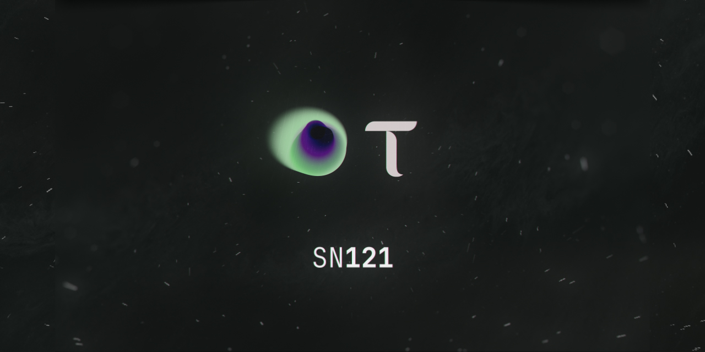

### Incentivizing The Creation and Benchmarking of Commercial AI Capabilities for Business

---

## Overview

SN121 is an incentivised AI development network designed to create and benchmark commercial AI capabilities for real business use.

The system operates through an open, competitive pipeline where real demand helps determine what gets built, and developer submissions are autonomously evaluated against structured benchmarks. The process works as follows:

1. **Real business demand informs development.** sundae_bar identifies demand signals, including customer requirements and broader market demand, that can be translated into structured SN121 Challenges.
2. **Developers compete to build the solution.** Developers (Bittensor miners) submit AI Skills designed to solve the Challenge.
3. **Submissions are autonomously benchmarked.** SN121 validators evaluate submissions against structured tests and scoring criteria, with emissions rewarding the highest-performing capabilities.
4. **The best capabilities feed into sundae_bar.** High-performing Skills can be integrated into sundae_bar’s commercial platform, expanding the AI available for customers to use.

This creates a direct development loop between commercial demand and decentralised AI development:

**Business Demand → SN121 Challenge → Developers Compete → Best AI Wins → Integrated into sundae_bar**

As the platform identifies new requirements, SN121 can create new Challenges around them. As developers produce better AI capabilities, sundae_bar’s Skills and Agents library expands, giving Scout an ever-growing set of capabilities to draw from when finding or composing AI solutions for customers.

SN121 therefore creates competitive pressure around AI that businesses actually need, using open development and objective benchmarking to continuously expand and improve the capabilities available through sundae_bar.

## About sundae_bar × SN121

SN121 is owned and operated by Sundae Bar AI PLC (AIM: SBAR), a London-listed company. Launched in June 2025, sundae_bar operates an enterprise AI platform where businesses can discover, deploy and manage AI Skills, AI Agents and bespoke AI solutions through one simple interface.

SN121 powers this ecosystem as sundae_bar’s decentralised AI development network on Bittensor. Real business demand informs structured development challenges, developers compete to build the required AI capabilities, and submissions are autonomously benchmarked to identify the highest-performing solutions. The best capabilities can then be integrated into the sundae_bar platform for commercial use, creating a direct loop between customer demand, AI development and commercial deployment.

## Platform Roles

**sundae_bar Platform:** Identifying Business Demand, Orchestrating and Commercialising AI Capabilities

**SN121:** Developing, Testing and Benchmarking AI Capabilities

## Economic Mechanism

SN121 is designed to develop toward a revenue-backed economic model that connects commercial activity on the sundae_bar platform with the subnet economy.

Businesses will access AI through a flat-rate Agent subscription together with usage-based fees. As commercial revenue grows, a portion of this revenue is intended to support buybacks of ALPHA (121), creating a direct link between commercial usage of sundae_bar and demand for the subnet token.

Separately, SN121 uses emissions to reward developers for building the highest-performing AI capabilities against structured Challenges and benchmarks.

Over time, the intention is to create an economic loop in which real business demand drives what gets built, developer competition improves the AI available through sundae_bar, and commercial usage creates demand for ALPHA (121).

### Operating Modes

1. **Pre-Revenue:** Controlled emissions designed to support developer participation and continued development on SN121.
2. **Commercial Revenue:** A portion of revenue generated through sundae_bar is intended to fund buybacks of ALPHA (121), creating a direct economic link between commercial usage and demand for the subnet token.

## Launch and Automated Evaluation

SN121 evaluates commercial AI **skills** against structured, challenge-specific benchmarks. Each Challenge is a bounded capability: a real business workflow.

**Challenges as benchmarks.** sundae_bar turns demand signals into Challenges: a public brief plus an evaluation suite. The suite is **open to audit** on the Lab challenge page: scenarios, dataset, rubric, graders, and `suite.yaml`, which tells the evaluation system how to run the suite. New Challenges are released as a rolling series so the capability library grows over time.

**Skill development.** Developers (Bittensor miners) submit a `SKILL.md`, a skill file that teaches an agent how to perform the Challenge. Submissions are made through the sundae_bar Lab while the Challenge is open.

**Automated evaluation.** Validators run every submission through the same harness and the published `suite.yaml`. A base agent loads the skill, works a **set of scenarios** (not a single prompt), and is scored by the suite’s graders. Multiple scenarios produce a more stable, integral score than one lucky run. Each scored result includes grader rationale that miners can download and inspect.

**Validator execution.** sundae_bar runs the scoring validator that evaluates submissions and posts on-chain weights. Ranking is deterministic: highest best score, then earliest qualifying submission. Incentive weights are decided from that leaderboard and submitted on-chain (`setWeights` on SN121).

The eval itself is built to be fair, non-biased, and fully auditable. Each skill is run across **multiple scenarios** and scored by **several independent graders** (procedure-following, output quality, holistic rubric, and deterministic checks such as novelty). No single prompt or single judge decides the result. Grader weights, the suite, and per-test rationales are published, so anyone can recompute how a score was produced. That robustness is the incentive mechanism: emissions follow a leaderboard that miners can inspect, not a private score.

Some SN121 validators **child-key to sundae_bar’s scoring validator**. Because that evaluation is already extensive (multiple scenarios, several graders, a published suite), additional inference from other validators is unlikely to change the outcome. Child-keying lets them set the **same** weights from that result rather than re-running the stack. That does **not** change the incentive mechanism. Who is #1, how long they hold it, and what share they receive are still determined by the published scores and the on-chain weight policy. Child keys amplify that vote; they do not invent a second ranking. Independent operators can still run the open-source validator themselves. Final incentive remains Bittensor consensus across stake.

**Rewards.** Emissions accrue to the miner who **holds #1**. This is winner-takes-all by **time at the top**, not a single payout at Challenge close. Holding the lead across more weight-setting cycles earns more alpha. Emissions settle at the subnet epoch, so explorer incentive can lag a leaderboard change.

The current share of validator weights assigned to the #1 miner is **40%**. sundae_bar reserves the right to change this percent at any time. For the live figure, review the weight extrinsics from our validator on [Taostats](https://taostats.io/validators/5EL9y2gdesAcPiPmoyFKABToiui3RkXewiKxdTMmes34ZdNf/rewards). Between Challenges, **100% of miner emissions are burned**. If you check that page while no Challenge is active, you should expect to see 100% assigned to UID 0. That is intended, not a misconfigured leaderboard.

**Commercial use.** High-performing skills can be integrated into sundae_bar’s platform and become part of the library Scout draws on when composing solutions for customers. sundae_bar reserves the right to modify an integrated skill so it better fits the product and customer use case. When that happens, the listing is labelled as built on the sundae_bar Lab.

## What Miners Submit

SN121 is **skill-first**. Miners submit a **skill file** (`SKILL.md`): instructions, procedures, and constraints an agent can follow to complete the Challenge.

The evaluation harness is fixed. What is tested is whether *this skill* improves performance on the published suite. That format is also what sundae_bar can host, list, and compose. Winning skills are the unit that feeds the commercial library.

## Technical Flow (Rolling Challenge Cycle)

SN121 runs **one Challenge at a time**, then the next. It is a rolling series of capability contests, not a permanent generalist leaderboard.

**1. Challenge released.** sundae_bar publishes a Challenge (brief + evaluation suite, including `suite.yaml`). Submissions open on the Lab. The suite is downloadable for audit.

**2. Skill submission.** Miners may submit and iterate on `SKILL.md` files while the Challenge is open, subject to submission limits (see below). Each accepted submission is queued for evaluation.

**3. Testing and scoring.** Validators evaluate submissions against the suite’s scenarios and graders. The leaderboard updates as scores return. On-chain weights follow the current #1, so incentive starts accruing as soon as a miner takes the lead.

**4. Qualifying score → review → close.** The Challenge stays open until a submission clears the **qualifying bar (currently 80%)**. At that point two things happen: sundae_bar queues a **research agent** to observe and interpret whether the skill is at a pace we want for commercial use, and a **closing window** begins (typically a few hours, aligned so the current #1 can still earn, including by timezone where it matters). If that review says the capability is not yet where we want it commercially, **the Challenge can stay open longer**.

**5. Close and next Challenge.** When the Challenge ends, submissions stop and **emissions for that Challenge end**. If no new Challenge has started, **100% of miner emissions are burned** until the next Challenge is live (on-chain this appears as 100% to UID 0). High-performing skills may be taken into sundae_bar’s commercial library, subject to the commercial-use terms above. Then a new Challenge opens and the cycle repeats.

## Submission Limits

Each evaluation takes **several minutes**. Limits exist so the queue does not overflow and the competition stays actively competitive. A stalled queue means the current #1 keeps collecting while everyone else waits.

There are two caps:

- A **daily limit** (rolling 24-hour window).
- A **per-Challenge limit** for the life of that Challenge.

Exact numbers can change. We reserve the right to adjust them. When you submit, the Lab shows **how many submissions you have remaining for the day** so you can track usage yourself.

## How an evaluation works

Every Challenge ships a **public suite bundle** on the Lab challenge page. Nothing about the quality scoring path is hidden. Download it, read it, replay the logic against the results JSON.

### The files

| File | Purpose |
|---|---|
| `suite.yaml` | The eval manifest. Names the dataset, the target (a fixed agent harness with a single `load_skill` tool), which graders run, their weights, which models they use, and the gates (pass/fail). Everything else is orchestrated from here. |
| `dataset.jsonl` | One row per scenario. Each row has three parts: the task the agent sees, the reference answer, and per-scenario grading hints. Scenario count varies by Challenge. |
| `rubric.txt` | The prompt template for the rubric / model-judge grader. A holistic scoring rubric, filled per-scenario with that row’s metadata. |

**Models.** Harness and judge models are **not** a single subnet-wide default. They are chosen per Challenge to match a **realistic stack for the use case** that skill is meant to serve: the kind of model an agent would actually call in that workflow. Read the live `suite.yaml` for that Challenge.

### What’s in each dataset row

- `input`: the only thing the base agent sees.
- `ground_truth.output`: the reference “good” answer. Held back from the agent; given to the judges to set the quality bar.
- `ground_truth.metadata`: per-scenario grading hints, also held back. Examples: scenario type, capability focus, how to weight rubric dimensions for this scenario, what each dimension means here, whether it is a trap, OOD / novelty grouping, difficulty, judge notes.

### What the base agent gets

A fixed harness with one tool, `load_skill`, which returns the miner’s submitted `SKILL.md` verbatim. The harness loads the skill before answering, then responds to `input`. It never sees the reference answer, the metadata, or the rubric, only the scenario. Which model runs that harness is in `suite.yaml` for that Challenge.

### The graders that produce the score

Weights are published in that Challenge’s `suite.yaml` and appear again on the scored **results JSON**. To audit a row: take each grader’s published weight, multiply by that grader’s score, sum them, then average across scenarios. You do not have to take the leaderboard number on trust.

A typical quality stack (weights normalize to 100%; confirm on the Challenge you are scoring):

| Grader | Weight | What it measures |
|---|---|---|
| **skill_use** | 30% | Did the agent follow the skill’s procedure vs freelance or pretend? Reads the submitted skill, the agent’s output, whether `load_skill` was called, and the scenario. Scores sub-criteria (e.g. novel-knowledge, knowledge-applied, situational-judgment, output-naturalness) and averages them. |
| **scenario_quality** | 30% | How good is the output against this scenario’s quality bar, independent of whether the skill was followed. Reads the agent’s output, the reference, and that row’s rubric weights/descriptions. Weighted average of the scenario’s criteria, minus penalties for prohibited moves. |
| **rubric (model-judge)** | 30% | Holistic judgment using `rubric.txt` filled with this scenario’s metadata plus the submission and reference. Typical dimensions: contextual judgment, output quality, adaptability, domain knowledge, communication, with an anti-template / novelty instruction. Returns one score. |
| **novelty_check** | 10% | Deterministic (no model). Compares this output to the agent’s other outputs in the same novelty group. Near-identical boilerplate across scenarios drops toward 0. Catches template-farming. |

**Final score:** per scenario = weighted average of those graders; across scenarios = simple mean.

### The pre-gates (kept deliberately opaque)

`skill_alignment` and `dataset_derived` are weight-0 pass/fail gates. They add nothing to the quality score. Their job is to detect a skill built to win the Challenge or exploit the scoring system rather than teach a genuine, production-grade capability, and to stop the run early, before the agent or any paid judge runs. A skill that trips either gate has the **entire submission zeroed**. We do not publish how they work.

## Summary

sundae_bar × SN121 creates a direct loop between real business demand, competitive AI development and commercial deployment. Demand signals identified through sundae_bar can be translated into structured SN121 Challenges, where developers compete to build AI capabilities and submissions are benchmarked against defined performance criteria.

The highest-performing Skills can then be integrated into the sundae_bar platform, expanding the capabilities available to businesses and giving Scout an ever-growing library of AI to draw from when finding or composing solutions for customers. As new customer requirements emerge, they can inform new Challenges, creating a continuous development cycle driven by real-world demand.

As commercial usage grows, a portion of revenue is intended to support buybacks of ALPHA (121), creating a direct economic link between activity on the sundae_bar platform and demand for the subnet token.

Real business demand drives what gets built. SN121 competes to build it. sundae_bar puts the best AI to work.
